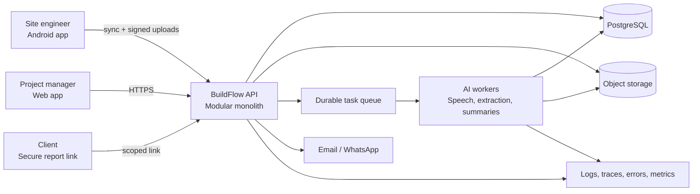
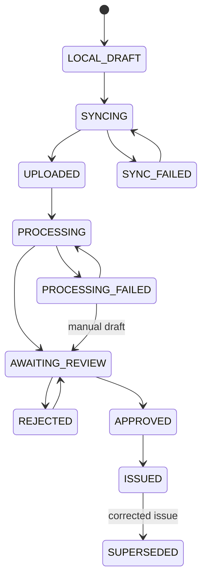
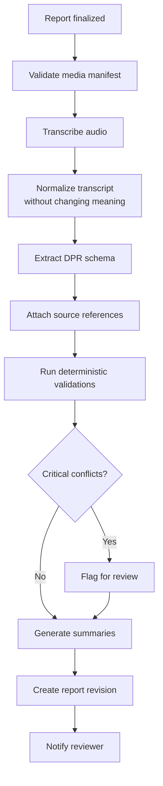

# BuildFlow AI — Technical Architecture

**Status:** MVP release-candidate architecture
**Version:** 0.3
**Last updated:** 2026-07-19  
**Scope:** MVP through paid beta

## 1. Architecture decision

BuildFlow starts as a **modular monolith with asynchronous workers**, not a collection of microservices. It uses PostgreSQL as the transactional source of truth, object storage for evidence, and an offline-first mobile data layer. AI is a replaceable processing subsystem, never the database of record.

This gives the team fast iteration, simple transactions, and clear boundaries without paying the operational cost of distributed services prematurely.

**Implementation status (2026-07-19).** The complete-MVP build (Phases A–F, `phases.md` §0)
is implemented on the audited DPR vertical slice. Where the implementation deviates from
the preferred stack in §4, the deviation and its reasoning are recorded in `docs/adr/`;
current ADRs:

- ADR-0001 — API served by Next.js route handlers/server actions (modular monolith) instead
  of a separate NestJS deployable for the MVP; NestJS extraction path preserved.
- ADR-0002 — One Drizzle layer over two Postgres drivers: real PostgreSQL (Docker/managed)
  as the production path, embedded PGlite as the zero-dependency test/dev default.
- ADR-0003 — Durable background work via transactional outbox + DB-backed job runner behind
  a queue port. It is the MVP runner; Cloud Tasks is an extraction option after measured
  throughput or isolation needs justify another managed component.
- ADR-0004 — Google Cloud production runtime: Cloud Run, Cloud SQL PostgreSQL, private GCS,
  Secret Manager and Vertex AI Gemini; no VM or graph database.

The release candidate uses Next.js route handlers/server actions rather than NestJS,
repository-native CSS rather than Tailwind/shadcn, the portable credential/session adapter
rather than Supabase Auth, and allow-listed JSON logging rather than a full OpenTelemetry
exporter. The production MVP runs on Cloud Run and Cloud SQL with GCS evidence storage and
Vertex AI Gemini behind the existing provider adapters.

## 2. Architecture principles

1. **PostgreSQL first.** Relational records, JSONB, full-text search, `pgvector`, and PostGIS cover the initial product.
2. **Graph later.** Add a graph projection only after measured query patterns cannot be served cleanly from PostgreSQL.
3. **Offline-first capture.** A successful local save is the first acknowledgment to a field user.
4. **Evidence is immutable.** Original uploads and issued report versions are retained according to policy.
5. **AI is asynchronous.** Capture never waits for transcription or extraction.
6. **Human approval is a domain boundary.** Draft facts cannot silently become approved records.
7. **Provider portability.** Speech, LLM, OCR, messaging, and storage access sit behind narrow adapters.
8. **Tenant isolation by construction.** Tenant context is explicit at every layer.
9. **Observability is part of the feature.** Each report is traceable across upload, AI stages, review, and issue.
10. **Prefer boring infrastructure.** Add components only when a measured requirement demands them.

## 3. System context



## 4. Recommended stack

Versions should be pinned by the lockfile and automated updates. Use the current supported stable release at project initialization; do not embed “latest” tags in production images.

| Layer | Choice | Reason |
|---|---|---|
| Language | TypeScript for product code; Python for AI/document workers | Shared types across web/mobile/API; Python has the strongest document and ML ecosystem. |
| Monorepo | pnpm workspaces + Turborepo | Fast builds, shared contracts, focused CI, simple developer workflow. |
| Web | Next.js App Router + React + TypeScript | Mature server rendering, routing, accessibility, and dashboard ecosystem. |
| Web UI | Tailwind CSS + shadcn/ui primitives + Radix | Accessible foundations with complete visual ownership. |
| Mobile | Expo + React Native + Expo Router | Android-first delivery, camera/audio/file APIs, OTA-safe JS updates, shared TypeScript. |
| Mobile local data | `expo-sqlite` with SQLCipher-enabled development and production builds | Durable offline drafts and queues; encrypted device storage. |
| Server state | TanStack Query | Explicit caching, mutation, retry, and invalidation behavior. |
| Forms and validation | React Hook Form + Zod | Performant capture and shared runtime schemas. |
| API | NestJS with Fastify adapter and OpenAPI | Modular boundaries, dependency injection, validation, mature operational structure. |
| Database access | Drizzle ORM plus reviewed SQL migrations | Strong TypeScript inference without hiding PostgreSQL features such as RLS, JSONB, vectors, and PostGIS. |
| Primary database | Cloud SQL PostgreSQL 16 in Mumbai | SQL source of truth with automatic backups, PITR, RLS, `pgvector`, and PostGIS support. |
| Authentication | PostgreSQL-backed credentials and server-side sessions behind `AuthPort` | No external identity key is required; business authorization remains in BuildFlow and the adapter remains replaceable. |
| Evidence storage | Private Google Cloud Storage in Mumbai behind `StoragePort` | Uniform bucket access, public-access prevention, object versioning and short-lived signed URLs. |
| Background work | Transactional PostgreSQL queue plus Cloud Run worker pool | Idempotent leases/retries/dead letters without adding a broker before measured need. |
| Runtime | Google Cloud Run service, job and worker pool in Mumbai | Container portability, web autoscaling, explicit migrations and continuous pull-based work. |
| AI orchestration | Small internal workflow/state machine; no agent framework in MVP | The pipeline is deterministic and auditable. Add an agent SDK only for genuinely tool-using flows. |
| LLM, vision and OCR | Vertex AI Gemini behind `AI_PROVIDER=gemini` | Workload identity, multimodal extraction and reasoning with schema validation; model IDs remain runtime configuration. |
| Speech | Gemini multimodal transcription for the MVP; benchmark Chirp 3 on representative field audio | Provider choice must be based on Indic language, code-mixing, noise, latency and cost evidence. |
| PDF | HTML/CSS templates rendered by Playwright/Chromium in a worker | Deterministic, brandable PDFs using the same design tokens as web. |
| Messaging | Meta WhatsApp Cloud API behind a messaging adapter; transactional email provider | Direct control and future provider portability. |
| Observability | OpenTelemetry + Google Cloud Logging/Monitoring + Sentry | Cross-service traces, infrastructure metrics, and product-facing error diagnosis. |
| Analytics | PostHog with redacted, allow-listed events | Product adoption data without uploading customer content. |
| Testing | Vitest, Playwright, React Native Testing Library, Pytest, Testcontainers | Unit, contract, browser, mobile, worker, and real-Postgres coverage. |
| Delivery | GitHub Actions + Docker + OpenTofu | Reproducible CI/CD and infrastructure with reviewable plans. |

### Why this is the best fit for this project

- One TypeScript domain model serves web, mobile, and API.
- Python is isolated to work where its ecosystem is materially better.
- Managed infrastructure preserves founder time during pilots.
- PostgreSQL prevents premature database fragmentation.
- Storage and AI provider changes remain isolated behind ports rather than rewriting the domain.
- Cloud Run handles bursty AI workloads and can scale idle workers down.

## 5. Source-backed technology notes

- Next.js recommends the App Router for current React features: <https://nextjs.org/docs/app>
- Expo documents SQLite persistence and local-first patterns: <https://docs.expo.dev/versions/latest/sdk/sqlite/> and <https://docs.expo.dev/guides/local-first/>
- Cloud SQL documents supported PostgreSQL extensions, including `pgvector` and PostGIS: <https://docs.cloud.google.com/sql/docs/postgres/extensions>
- Cloud Storage documents time-bounded V4 signed URLs: <https://docs.cloud.google.com/storage/docs/access-control/signed-urls>
- Vertex AI documents Gemini models and lifecycle: <https://docs.cloud.google.com/vertex-ai/generative-ai/docs/learn/model-versions>
- Vertex AI documents `gemini-embedding-001`: <https://docs.cloud.google.com/vertex-ai/generative-ai/docs/embeddings/get-text-embeddings>
- Cloud Run autoscaling behavior is documented here: <https://docs.cloud.google.com/run/docs/about-instance-autoscaling>

## 6. Repository layout

```text
buildflow/
├── apps/
│   ├── web/                 # Next.js manager/admin experience
│   ├── mobile/              # Expo Android/iOS field app
│   └── worker/              # TypeScript durable-job worker
├── packages/
│   ├── ai/                  # AI/OCR provider ports and deterministic mocks
│   ├── auth/                # Authentication port and credential/session adapter
│   ├── contracts/           # Zod contracts and OpenAPI 3.1 document
│   ├── domain/              # Framework-free domain types and policies
│   ├── db/                  # Drizzle schema, SQL migrations, seeds
│   ├── jobs/                # Transactional queue, leasing, retry and dead letters
│   ├── lifecycle/           # Export, retention and deletion
│   ├── notify/              # Notification ports and delivery registry
│   ├── observability/       # Logging/tracing conventions
│   ├── pdf/                 # Issued DPR/compliance PDF rendering
│   ├── pipeline/            # Processing stages and job handlers
│   └── storage/             # Local, Google Cloud Storage and Supabase adapters
├── prompts/
│   ├── dpr-extraction/      # Versioned prompt + schema + eval metadata
│   └── dpr-summary/
├── infrastructure/
│   ├── environments/
│   └── modules/
├── docs/
│   ├── adr/                 # Architecture Decision Records
│   ├── runbooks/
│   └── threat-models/
├── PRD.md
├── Architecture.MD
├── rules.md
├── phases.md
├── design.md
└── memory.md
```

### Deployment locality

Cloud Run, Cloud SQL and GCS are deployed in `asia-south1` (Mumbai). Vertex AI uses the
approved model endpoint selected at deployment; record any customer-specific residency
constraint before processing their content. Do not scatter storage, database and compute across
additional regions without an ADR and measured need.

## 7. Domain modules

The API is one deployable, but modules communicate through explicit application interfaces and domain events.

| Module | Owns |
|---|---|
| Identity | User profile mapping, sessions, device registrations. |
| Organizations | Tenants, memberships, capabilities, subscription state. |
| Projects | Project settings, locations, activities, report expectations. |
| Capture | Drafts, media manifests, sync commands, idempotency. |
| Reports | DPR lifecycle, structured facts, review, approval, issued versions. |
| Evidence | Attachments, metadata, retention, signed-access policy. |
| AI Processing | Runs, stages, schemas, prompts, model/provider metadata, evaluations. |
| Notifications | In-app, email, WhatsApp templates, delivery status. |
| Search | Permission-aware lexical and semantic retrieval projections. |
| Audit | Append-only security and domain audit events. |
| Billing | Usage meters and plan entitlements; payment integration later. |

Do not import another module’s database repository directly. Call its application service or consume a committed domain event.

## 8. Core data model

All business tables carry `organization_id`; project-scoped tables also carry `project_id`. IDs are UUIDv7 or another monotonic UUID implementation supported consistently across languages.

### Primary entities

```text
Organization
  ├── Membership
  ├── Project
  │     ├── ProjectMembership
  │     ├── Location
  │     ├── Activity
  │     └── DailyReport
  │            ├── ReportRevision
  │            ├── WorkItem
  │            ├── LabourEntry
  │            ├── MaterialEntry
  │            ├── Blocker
  │            ├── EvidenceLink
  │            ├── ReviewDecision
  │            └── IssuedDocument
  ├── Attachment
  ├── ProcessingRun
  │     └── ProcessingStage
  ├── Notification
  └── AuditEvent
```

### Report state machine



State transitions are server-enforced. `ISSUED` content is immutable; a correction creates a new revision and supersedes the earlier issue.

## 9. Multi-tenancy and authorization

### Enforcement layers

1. Authentication provider validates identity.
2. API resolves organization and project membership.
3. Application policy checks the required capability.
4. Repository requires explicit tenant context.
5. PostgreSQL RLS provides defense in depth.
6. Storage object paths and policies include tenant/project boundaries.

### Required practices

- Never accept `organization_id` from a request body as authoritative.
- Resolve tenant context from the authenticated route/session and verified membership.
- Background jobs carry signed tenant context and re-authorize sensitive actions.
- Service-role database access is limited to server workloads and cannot bypass application policy casually.
- Search results are filtered before ranking and again before response serialization.

## 10. Offline sync architecture

The mobile app uses SQLite as a local command store, not merely a response cache.

### Local tables

- `local_reports`
- `local_attachments`
- `sync_commands`
- `sync_attempts`
- `local_reference_data`

### Sync protocol

1. Mobile creates a local report ID and monotonic command sequence.
2. Each mutation receives an idempotency key derived from device, entity, and command ID.
3. API upserts the report manifest and returns signed upload instructions.
4. Mobile uploads attachments independently and records checksums.
5. API finalizes the manifest only after validating expected objects.
6. Finalization creates the processing task through the transactional outbox.
7. Mobile reconciles authoritative server state by cursor.

### Conflict policy

- Draft text: latest explicit user edit wins, with revision history.
- Attachment sets: additive unless a user explicitly removes an unissued attachment.
- Approved or issued reports: mobile edits are rejected and require a new revision.
- Reference data: server wins; deleted items become unavailable for new reports but remain on history.

## 11. Upload and evidence pipeline

1. Client requests an upload session with file metadata.
2. API verifies project permission and returns a short-lived signed URL.
3. Client uploads directly to object storage using a generated object key.
4. Storage event or explicit completion triggers validation.
5. Worker verifies content type, size, checksum, malware policy, and metadata.
6. Derivatives are created: thumbnail, normalized image, audio waveform/codec if required.
7. Original object is never overwritten.

Object keys must be opaque and must not contain customer names, project names, phone numbers, or report narrative.

## 12. AI processing pipeline



### Pipeline rules

- Each stage is independently retryable and idempotent.
- Stage input/output is versioned and stored separately.
- Structured output must validate against the schema before persistence.
- Deterministic validators check dates, units, totals, project references, duplicates, and impossible states.
- A provider refusal or malformed result becomes a visible processing error, never an empty “successful” report.
- Model selection comes from configuration with evaluated, pinned snapshots where available.
- Provider secrets exist only in server-side secret storage.

### Model routing

Use capability classes rather than model IDs in domain code:

- `speech.indic_field_audio`
- `extract.dpr_fast`
- `extract.document_invoice`
- `reason.project_summary`
- `embed.project_search`

The provider registry maps a capability to a current evaluated model. Changing a mapping requires an eval report and staged rollout.

## 13. Search and retrieval

### MVP

- PostgreSQL full-text search for names, activities, transcript, and report text.
- `pgvector` embeddings for approved transcript/report chunks.
- Metadata filters for tenant, project, date, report status, location, and content type.
- Results show source report and evidence, not free-floating AI prose.

### Grounded answers later

A future natural-language answer must:

1. resolve user scope;
2. retrieve permission-filtered records;
3. cite internal records precisely;
4. distinguish approved facts from drafts;
5. state when evidence is insufficient;
6. never mutate domain records without a separate authorized command.

### When to add a graph database

Consider Neo4j or another graph projection only when all are true:

- recurring production queries traverse many heterogeneous relationships;
- PostgreSQL recursive queries or materialized projections are measurably inadequate;
- the ontology is stable enough to maintain;
- a clear owner and synchronization strategy exist.

PostgreSQL remains the source of truth; any graph is a rebuildable projection.

## 14. API design

- REST/JSON with generated OpenAPI 3.1 documentation.
- `/v1` prefix for public client APIs.
- Zod/JSON Schema contracts generated or shared without duplicating semantics.
- Cursor pagination for timelines and audit records.
- RFC 9457 Problem Details-shaped errors.
- `Idempotency-Key` required for create/finalize/approve/issue operations.
- Optimistic concurrency through entity version or ETag for review edits.
- API dates are ISO 8601; quantities store decimal value plus UCUM-inspired unit code.
- Currency uses integer minor units and ISO currency code; never floating point.

## 15. Events and durable work

Use the `job` table as a transactional queue written in the same transaction as the domain
change. The worker leases rows with bounded retries/backoff, parks terminal failures and
emits allow-listed health signals. A future Cloud Tasks dispatcher may consume the same
versioned commands without changing domain transactions.

Example events:

- `report.submitted.v1`
- `attachment.verified.v1`
- `report.processing_completed.v1`
- `report.awaiting_review.v1`
- `report.approved.v1`
- `report.issued.v1`

Event schemas are immutable. Breaking changes create a new version.

## 16. Security baseline

- Threat-model authentication, tenant isolation, signed uploads, public report links, AI prompt injection, and messaging webhooks before pilot launch.
- Use managed secret storage and workload identity; no long-lived cloud keys in CI.
- Verify webhook signatures and reject replays.
- Apply rate limits by identity, tenant, IP risk, and endpoint cost.
- Scan uploads according to file type and risk.
- Sanitize filenames and rendered HTML.
- Apply Content Security Policy to web surfaces.
- Maintain append-only audit events for approvals, issuance, membership, exports, and retention actions.
- Public links are revocable, scoped to one issued artifact, and expire by policy.
- Support access is just-in-time, audited, time-limited, and disabled by default.

## 17. Data lifecycle

### Classes

| Class | Examples | Default posture |
|---|---|---|
| Identity | name, mobile, email | Minimize and restrict. |
| Operational | DPR facts, blockers, activities | Retain by customer policy. |
| Evidence | audio, photos, invoices | Private, signed access, configurable retention. |
| Derived AI | transcripts, embeddings, summaries | Inherit source permissions and deletion. |
| Audit | approvals, issuance, access | Append-only with defined retention. |
| Telemetry | timing, error code, usage | No customer narrative or raw media. |

Deletion cascades to derived data and vector entries while preserving only a signed,
content-free deletion receipt. Organization export produces an audited ZIP of tenant CSV
registers plus attachment manifest. Retention is configured per organization and the daily
worker removes expired evidence and inherited AI derivatives together. Account deletion
requires a distinct second owner and a seven-day grace period.

## 18. Observability

Every request and job carries:

- `trace_id`
- `request_id` or `job_id`
- `organization_id` as a protected structured attribute
- `project_id` where relevant
- `report_id`
- `processing_run_id`
- provider request ID
- prompt/schema/model version

Never log transcripts, report text, filenames, signed URLs, JWTs, phone numbers, or model prompts containing customer data. The MVP enforces this with an allow-listed JSON logger,
AsyncLocalStorage trace context, structured request/job events and a provider/job health page.

### Service-level indicators

- acknowledged local drafts successfully synchronized;
- upload completion latency and failure rate;
- processing success by stage/provider/language;
- time from submission to review-ready;
- review and issue latency;
- cost per approved report;
- cross-tenant authorization denials;
- notification delivery success.

## 19. Testing strategy

### Test pyramid

- Domain unit tests for state transitions and policies.
- Contract tests for API schemas, events, and provider adapters.
- Integration tests against real PostgreSQL with RLS enabled.
- Worker tests with recorded provider fixtures and schema validation.
- End-to-end web tests for review and issue.
- Mobile tests for local save, offline restart, reconnect, duplicate retry, and large attachment queues.
- Security tests for tenant isolation and role boundaries.
- AI evals for extraction fields and critical-error cases.

### Mandatory pre-release scenarios

1. App killed immediately after local save.
2. Network lost halfway through a large upload.
3. Same finalize request delivered five times.
4. AI provider times out after transcription succeeds.
5. Manager edits while a stale client is open.
6. User removed from project before a queued command syncs.
7. Signed link is expired or revoked.
8. Malicious text in transcript or uploaded document attempts prompt injection.
9. Tenant A requests a known Tenant B object ID.

## 20. Environments and delivery

| Environment | Purpose | Data policy |
|---|---|---|
| Local | Developer feedback | Synthetic data only. |
| Preview | Pull-request review | Ephemeral, synthetic data, no production secrets. |
| Staging | Release validation and evals | De-identified consented fixtures only. |
| Production | Customer usage | Region, access, backup, and retention controls enforced. |

Deployment flow:

1. Secret scan, type-check, unit/integration tests and contract checks.
2. Build pinned container images and produce an SBOM.
3. Run database migration checks against an ephemeral database.
4. Run integration, contract, and critical AI eval gates.
5. Deploy to staging and run accessibility, navigation, registration/onboarding,
   capture-to-issue and managed-storage smoke tests.
6. Apply reviewed infrastructure and migration plan.
7. Deploy production gradually with automatic rollback signals.

## 21. Scale path

### Stage A — design partners

One API deployment, one worker deployment, PostgreSQL, object storage, Cloud Tasks, and basic observability.

### Stage B — paid beta

Separate CPU-intensive PDF/document worker from AI worker; add read replicas only if measured; add dedicated caching/rate limiting if required.

### Stage C — multi-enterprise

Extract only proven bottlenecks or isolation domains, such as media processing or customer-specific integrations. Add SSO/SCIM, customer-managed keys, private networking, and dedicated deployments based on contracts.

### Stage D — intelligence platform

Build event-driven projections for portfolio analytics, graph traversal, and forecasting. Keep transactional commands in the core domain.

## 22. Architecture decision record triggers

Create an ADR before:

- adding a database or message broker;
- introducing a microservice;
- changing authentication provider;
- changing tenant isolation strategy;
- storing data outside the approved region;
- adding an AI provider or agent framework;
- permitting AI-triggered side effects;
- changing evidence immutability or retention;
- adding a customer-facing integration with financial or compliance impact.

## 23. Explicitly rejected for MVP

- Kubernetes.
- Kafka.
- Neo4j as a primary database.
- A vector database separate from PostgreSQL.
- Event sourcing for all domain state.
- Blockchain for report integrity.
- Autonomous multi-agent orchestration.
- Fine-tuning before a representative evaluation set exists.
- Direct client access using a privileged database key.
- Building separate services per product module.
