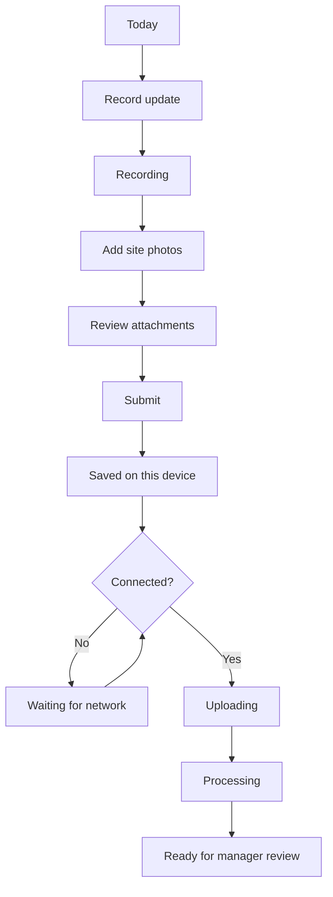

# BuildFlow AI — Product and Interface Design System

**Status:** Design baseline  
**Last updated:** 2026-07-13  
**Filename note:** `deisgn.md` preserves the filename requested for this project.

## 1. Design objective

BuildFlow must feel faster and safer than reporting through WhatsApp while producing a record that management trusts. The field experience optimizes for speed, clarity, outdoor conditions, one-hand use, low-end Android devices, intermittent connectivity, and mixed-language speech. The management experience optimizes for review, exceptions, evidence, and accountability.

## 2. Design principles

### Capture first, structure later

The primary field action is recording or photographing, not completing a long form. Ask for structured correction only after the first natural input.

### One obvious next action

Each screen should make the next action unmistakable: record, add photos, submit, review uncertainty, approve, or resolve a failure.

### Trust is visible

Users must see what came from the engineer, what AI extracted, what was edited, who approved it, and which version was issued.

### Offline is a state, not an error

The interface must say that work is safely stored locally and will sync later. Never use a generic red failure banner merely because the network is unavailable.

### Exceptions before dashboards

Managers need missing reports and unresolved blockers before charts. Data visualization is secondary to decisions.

### Forms are a fallback

Use structured controls for correction, approval, configuration, and legally required fields—not as the default capture experience.

### AI remains subordinate

Avoid anthropomorphic “AI knows” language. Use “Drafted from your update,” “Needs confirmation,” and “No supporting evidence found.”

## 3. Experience hierarchy

1. Preserve the user’s input.
2. Show current status.
3. Make the next action clear.
4. Surface uncertainty and blockers.
5. Provide evidence.
6. Provide summary and analytics.

## 4. Users and environments

### Field contributor

- Often standing or walking.
- May wear gloves or have wet/dusty hands.
- Uses an inexpensive Android phone.
- Works in sunlight, noise, heat, and patchy connectivity.
- May speak English, Hindi, Hinglish, or regionally mixed construction terms.
- Has little patience for setup or repeated data entry.

### Project manager

- Reviews several reports quickly, often on mobile and desktop.
- Needs to distinguish missing, uncertain, and critical information.
- Must correct a report without losing the original account.

### Director

- Looks for exceptions across projects.
- Needs a concise, credible explanation and the ability to drill into evidence.

### External client viewer

- Sees only deliberately issued information.
- Needs a polished, stable document or secure link—not internal review state.

## 5. Information architecture

### Mobile navigation

Use a maximum of four primary destinations:

1. **Today** — current project, expected update, upload and review status.
2. **Reports** — recent drafts and issued reports.
3. **Projects** — permitted projects and reference information.
4. **Account** — language, device sync, help, sign out.

The capture action remains prominent on **Today** and project screens; do not use a fifth tab solely for a floating action.

### Web navigation

- Portfolio
- Projects
- Review inbox
- Reports
- People
- Organization settings

Future modules do not appear as empty navigation items.

### Project sub-navigation

- Overview
- Daily reports
- Blockers
- Documents
- Settings, when permitted

## 6. Core mobile flow

### Today screen

Display:

- current project and report date;
- whether today’s report is expected;
- one primary **Record update** button;
- last sync state;
- any draft or action requiring the contributor;
- recent issued report link.

Do not begin with charts, activity feeds, or an AI chat box.

### Recording screen

- Large timer and waveform.
- Pause, resume, and finish controls.
- Screen stays awake during recording.
- Short prompt chips such as “Work completed,” “Labour,” “Materials,” “Blockers,” and “Tomorrow.” Chips are reminders, not required form sections.
- Clear statement that audio is stored locally until uploaded.
- If permission fails, offer a text note fallback without losing the flow.

### Photo screen

- Camera opens quickly with optional gallery import.
- Show the count and thumbnail rail.
- Preserve originals, but create upload-friendly derivatives.
- Allow optional photo labels after capture; never require labeling each image.
- Surface missing device location as neutral metadata, not a failure.

### Submission review

- Audio duration.
- Photo count.
- Optional one-line note.
- Project and date confirmation.
- Primary **Submit update** action.
- Secondary **Save and finish later**.

Avoid presenting the entire structured DPR before upload; the AI draft does not yet exist.

## 7. Sync and processing states

Use precise copy and icons:

| State | User-facing label | Meaning |
|---|---|---|
| Local draft | Saved on this device | Safe locally; not submitted. |
| Queued offline | Waiting for network | Safe locally; automatic retry. |
| Uploading | Uploading 3 of 6 files | Progress is active. |
| Uploaded | Upload complete | Server has all expected evidence. |
| Processing | Preparing report | Transcription/extraction is running. |
| Review-ready | Ready for manager review | Draft exists; not approved. |
| Rejected | Changes requested | Contributor action is required. |
| Approved | Approved | Internal approved record exists. |
| Issued | Report issued | A version was shared externally or finalized. |
| Recoverable failure | Couldn’t finish processing | Inputs are safe; retry/manual fallback available. |

Always answer three questions:

1. Is my data safe?
2. What is happening now?
3. Do I need to do anything?

## 8. Manager review experience

### Review inbox

Order sections by action:

1. Processing failures.
2. Reports with critical uncertainty.
3. Awaiting review.
4. Missing expected reports.
5. Recently approved.

Filters: project, date, status, contributor, and blocker presence.

### Report review layout

Desktop uses a two-pane layout:

- **Left:** structured DPR sections and editable fields.
- **Right:** transcript, audio player, and photos.

Selecting a field highlights its transcript timestamp or photo references. On small screens, use tabs with a persistent “Evidence” action rather than squeezing two columns.

### Field treatment

Each extracted field may show:

- source badge;
- `Needs confirmation` state;
- user-stated versus calculated label;
- edit history;
- remove or mark unknown action.

Do not show a pseudo-scientific numeric confidence percentage. Use meaningful bands only when they help review:

- **Supported** — direct source identified.
- **Check** — ambiguous or conflicting source.
- **Missing** — no support found.

### Approval

The approval footer includes:

- unresolved critical items count;
- recipient/audience preview;
- **Approve report** primary action;
- **Request changes** secondary action;
- explicit **Issue/send** action after approval.

Approval and external issuance are separate events. Do not combine them into an ambiguous “Done.”

## 9. Dashboard design

### Portfolio page

Lead with an exception summary:

- projects missing today’s report;
- reports awaiting review;
- unresolved critical blockers;
- processing failures;
- projects with repeated late reporting.

Then show a project list with current state, last approved report, open blockers, and responsible manager.

### Project overview

- Today’s report state.
- Current blockers.
- Seven-day reporting completeness.
- Latest issued report.
- Recent photo evidence.

Avoid “percentage complete” unless it is a user-approved schedule value with its origin and date.

## 10. Visual language

The system should feel calm, industrial, trustworthy, and modern. Construction cues come from utility and disciplined color—not hazard stripes, blueprint textures, or excessive orange.

### Color tokens

| Token | Light value | Use |
|---|---:|---|
| `brand-900` | `#102A43` | Primary navigation, strong text, dark surfaces. |
| `brand-700` | `#1F4E6D` | Primary controls and links. |
| `brand-100` | `#DCEAF2` | Selected and informational backgrounds. |
| `accent-600` | `#C65D16` | Main capture action and limited emphasis. |
| `accent-100` | `#FCE8D5` | Accent background. |
| `success-700` | `#16794B` | Approved/synced success. |
| `success-100` | `#DDF3E8` | Success background. |
| `warning-700` | `#996A00` | Needs review/offline queue. |
| `warning-100` | `#FFF2C6` | Warning background. |
| `danger-700` | `#B42318` | Destructive/final failure. |
| `danger-100` | `#FEE4E2` | Error background. |
| `neutral-950` | `#111827` | Primary text. |
| `neutral-700` | `#374151` | Secondary text. |
| `neutral-500` | `#6B7280` | Tertiary text. |
| `neutral-200` | `#E5E7EB` | Borders. |
| `neutral-50` | `#F9FAFB` | App background. |
| `surface` | `#FFFFFF` | Cards and documents. |

All status pairs need icon/text support and WCAG AA contrast. Safety yellow is reserved for warning—not branding.

### Dark and outdoor modes

- Provide dark mode for low-light use after the core light theme is complete.
- Outdoor high-contrast mode may increase text contrast, border weight, and control size.
- Do not simply invert photos or evidence.

## 11. Typography

### Interface font

Use **Inter** where available, with a system sans-serif fallback. For Devanagari, use **Noto Sans Devanagari** or a tested compatible font.

### Type scale

| Role | Size/line | Weight |
|---|---:|---:|
| Display | 32/40 | 700 |
| Page title | 28/36 | 700 |
| Section title | 22/30 | 650 |
| Card title | 18/26 | 600 |
| Body | 16/24 | 400 |
| Body strong | 16/24 | 600 |
| Supporting | 14/20 | 400 |
| Label | 14/20 | 600 |
| Caption | 12/16 | 500 |

Mobile body text must not drop below 16 px for primary reading. DPR PDFs use a separate print scale optimized for A4.

## 12. Spacing, layout, and geometry

- Base spacing unit: 4 px.
- Common steps: 4, 8, 12, 16, 24, 32, 48, 64.
- Mobile page gutter: 16 px; 20–24 px on larger phones.
- Web content maximum: 1440 px; reading columns remain narrower.
- Card radius: 12 px.
- Input/button radius: 10 px.
- Primary mobile touch target: minimum 48×48 dp.
- Desktop control height: minimum 40 px.
- Use borders and spacing before shadows. Shadows are subtle and limited to elevation changes.

## 13. Component patterns

### Primary capture button

- Large circular or rounded control.
- Microphone icon plus visible label.
- Accent color is reserved so this action remains prominent.
- Pressed, recording, paused, disabled, and permission-denied states.

### Status chip

- Icon + label + semantic background.
- Never color-only.
- Avoid more than two chips per list row; move secondary metadata into text.

### Evidence card

- Thumbnail or audio marker.
- Capture timestamp and uploader.
- Optional location metadata.
- Referenced report fields.
- Access and retention actions according to role.

### AI draft callout

Use a quiet brand-tinted surface with wording such as:

> Drafted from the submitted voice note and photos. Confirm highlighted items before approval.

Do not use sparkles on every AI-generated element.

### Empty state

Explain why the page is empty and give one action. Example: “No report is expected yet” is different from “Today’s report is missing.”

### Error state

Include:

- plain-language failure;
- whether data is safe;
- retry or alternative;
- trace/reference code for support.

## 14. Forms

- Group fields by user decision, not database table.
- Use sensible defaults from project settings.
- Mark optional fields explicitly; avoid a forest of required asterisks.
- Validate after blur or submission, not on every keystroke when disruptive.
- Preserve user input through navigation and failure.
- Use searchable selects only for genuinely large sets.
- Units appear next to quantity and persist with the value.
- Dates use user locale but show unambiguous format where cross-region confusion is possible.
- Never use a form to recreate what can be extracted from voice or a document and reviewed faster.

## 15. Tables and lists

- Use tables for comparable, scan-heavy desktop records.
- Convert to structured cards on mobile.
- Freeze the action/status column only when necessary.
- Align numbers by decimal and use tabular numerals.
- Preserve units in headings or cells.
- Provide sorting only where it answers a user question.
- Do not hide important actions in hover-only controls.

## 16. Data visualization

Charts are used only when a relationship is easier to see visually.

Approved MVP charts:

- reporting completeness over time;
- submission-to-approval latency;
- blockers opened versus resolved.

Rules:

- Always show labels, unit, period, and data status.
- Distinguish missing data from zero.
- Do not interpolate operational progress without stating the method.
- Avoid pie charts for many categories, decorative 3D, gauges, and red/green-only comparisons.

## 17. DPR document design

The issued DPR is an A4 portrait document optimized for print and mobile PDF viewing.

### Page 1

- Organization/project identity.
- Report date, document ID, revision, and issue status.
- Concise approved summary.
- Key work completed.
- Blockers and next-day plan.

### Following pages

- Work items by location/activity.
- Labour and material tables.
- Selected photo evidence with captions.
- Approval and issue metadata.
- Footnote explaining estimates, missing metadata, or corrections when relevant.

### Document rules

- Do not include unapproved internal notes in a client-safe report.
- Use the template version active at issue time.
- Repeat table headers across pages.
- Prevent photo/caption separation.
- Include “Superseded” visibly on older corrected versions when rendered later.

## 18. Language and content

### Tone

Direct, respectful, calm, and operational.

Use:

- “Saved on this device.”
- “2 items need confirmation.”
- “Your audio and photos are safe. Processing can be retried.”
- “No quantity was mentioned.”

Avoid:

- “AI magic completed!”
- “Low confidence: 47.3%.”
- “Something went wrong.”
- “You failed to submit.”
- “100% compliant.”

### Terminology

Use customer-familiar terms such as DPR, site, project, work item, labour, material, blocker, and tomorrow’s plan. Define e-MB and regulatory terminology in context; do not assume every role shares the same vocabulary.

## 19. Localization

- English and Hindi UI at MVP launch.
- Support code-mixed content without forcing translation.
- Store original transcript and optional normalized/translated text separately.
- Never replace the original account with a translation.
- Test truncation, numerals, date formats, and font rendering.
- Allow project-specific units and vocabulary aliases while preserving normalized values.

## 20. Accessibility

Target WCAG 2.2 AA for web and equivalent native accessibility practices.

- Visible focus states.
- Semantic headings and landmarks.
- Correct labels and error associations.
- Screen-reader names for icon controls.
- Captions/transcripts for audio.
- Alternatives for gestures.
- 200% text zoom without loss of primary function.
- Reduced-motion support.
- Contrast verified for all states.
- Audio recording status communicated visually, textually, and accessibly.

## 21. Notification design

Notifications are actionable, limited, and role-aware.

### Contributor

- Upload failed after retries.
- Manager requested changes.
- Report successfully approved, optionally batched.

### Manager

- Report awaiting review.
- Critical processing failure.
- Expected report missing after configured cutoff.

### Rules

- Do not include sensitive report narrative in lock-screen notifications.
- Deep-link to the exact task.
- Group routine reminders.
- Respect quiet hours and project timezone.
- External WhatsApp/email never contains unapproved details.

## 22. Design QA checklist

Before a primary flow ships, verify:

- Can it complete on a representative low-end Android device?
- Can it complete with the network off and recover later?
- Is the main action reachable with one hand?
- Is data safety clear at every state?
- Can a user distinguish draft, approved, and issued content?
- Are AI-supported and unsupported claims understandable?
- Can all actions complete with keyboard and screen reader where applicable?
- Does text work in English, Hindi, and realistic long-string cases?
- Are loading, empty, permission-denied, retry, stale, and partial-success states designed?
- Are destructive and external-sharing actions unambiguous?

## 23. First prototypes to create

1. Mobile Today and recording flow.
2. Offline queue and reconnect flow.
3. Photo attachment and submission flow.
4. Manager review with evidence linking.
5. Approval versus issuance flow.
6. Processing failure with manual fallback.
7. Portfolio exceptions page.
8. A4 DPR template with 3, 10, and 30 photos to test pagination.
